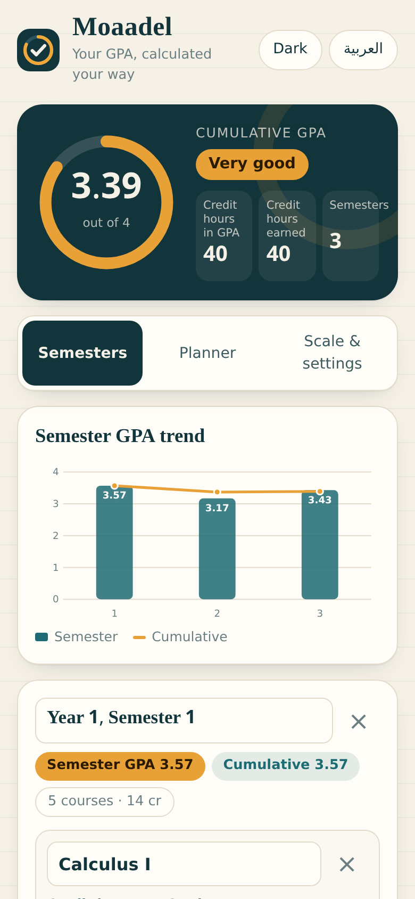
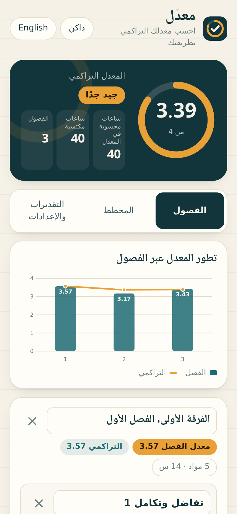
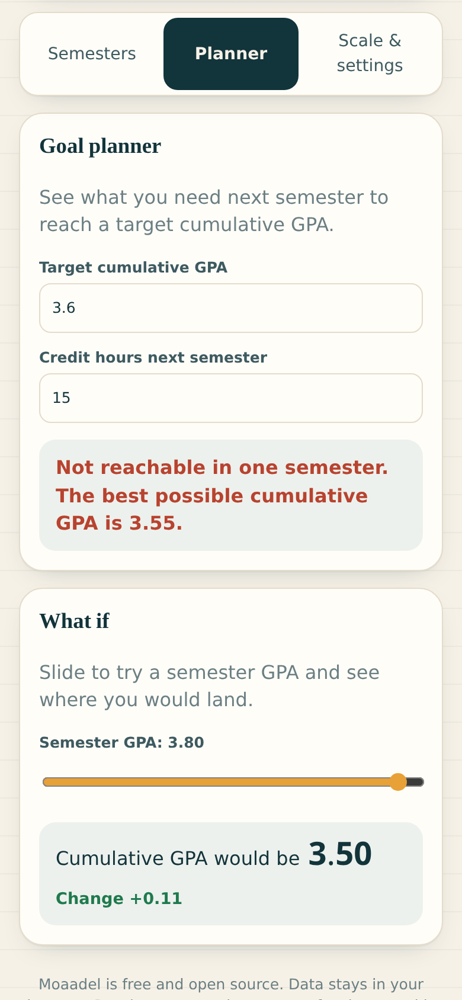
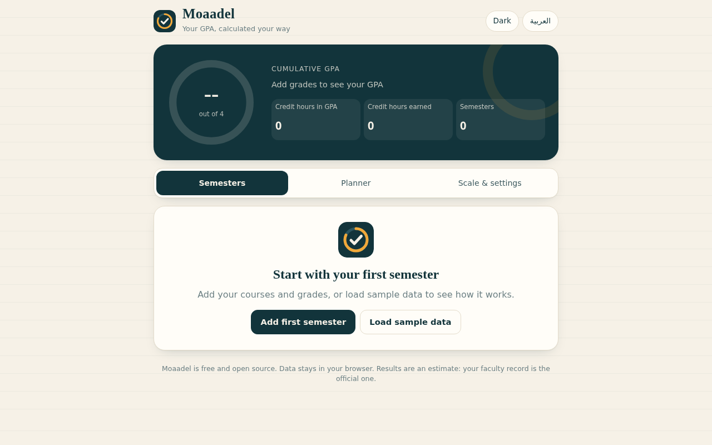
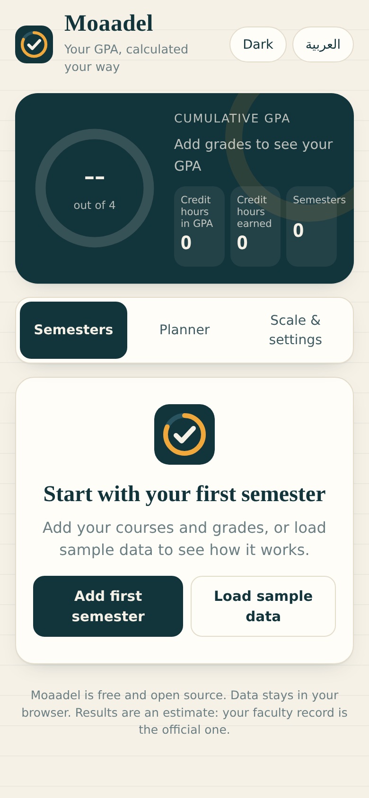
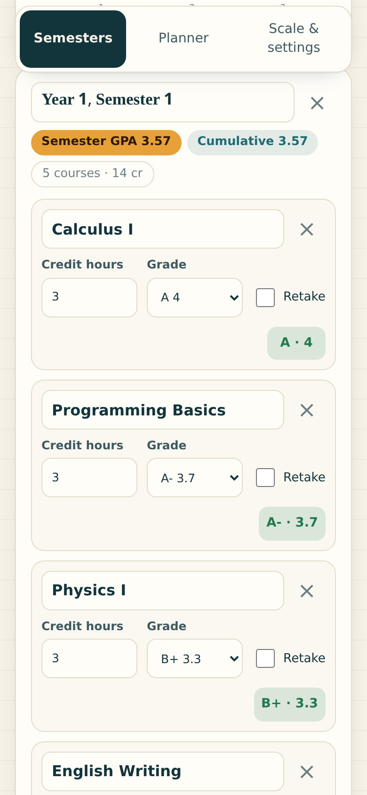
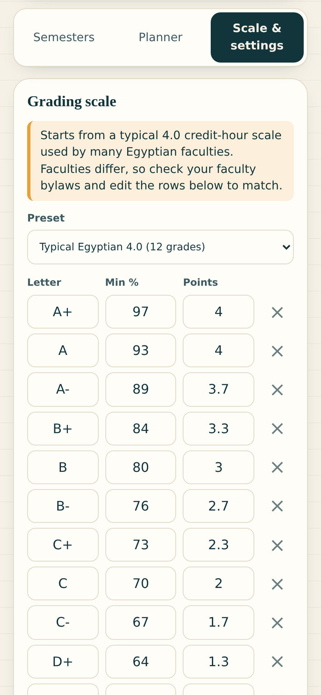
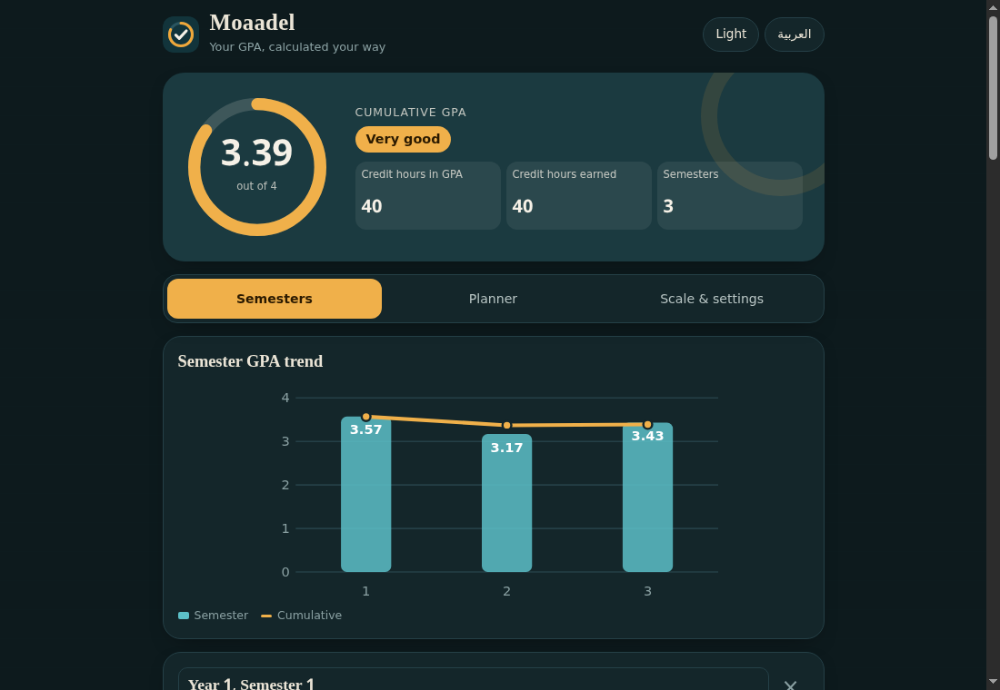

<p align="center"></p>

<h1 align="center">Moaadel | معدّل</h1>

<p align="center"><strong>A GPA and credit-hours calculator for Egyptian universities.</strong><br>
Editable grading scale, retakes, a goal planner, Arabic and English with full RTL. Runs in your browser, no account, no server.</p>

<p align="center"><a href="https://yousefkhames.github.io/moaadel/"><strong>Open the live app</strong></a></p>

<p align="center">
  
  
  
</p>

## Screenshots

Captured from the live site (https://yousefkhames.github.io/moaadel/).

<p>
  
  
</p>

## Why

Most GPA calculators assume one fixed scale and one fixed rule set. Egyptian faculties do not all agree on grade cut-offs, points, retake rules or honors levels. Moaadel starts from a typical 4.0 credit-hour scale and lets you change every number to match your faculty bylaws.

## Features

- **Semesters and courses.** Add as many as you need. Each course has a name, credit hours and a grade.
- **Cumulative and per-semester GPA**, credit hours counted, credit hours earned, and an honors label (Excellent, Very good, Good, Pass).
- **Letters or percentages.** Enter a letter, or type the score and let the scale pick the letter. `P` (pass) and `W` (withdrawn) are supported and stay out of the GPA.
- **Editable grading scale.** Three presets (typical Egyptian 4.0, a simple 4.0, an example 5.0) and a row editor. Bad scales (duplicate letters, no 0% row, and so on) are rejected with a message, and the last valid scale stays active.
- **Retakes.** Mark a course as a retake: it replaces the earlier attempt with the same name, or count every attempt, or cap the retake grade points. Your choice.
- **Rules you can set.** Passing points, rounding or truncating to two decimals, honors thresholds.
- **Goal planner.** What semester GPA do you need next term to reach a target? Plus a what-if slider.
- **Quick grade check.** Type a percentage, see the letter and points.
- **Backup.** Export and import JSON, copy a text summary, print.
- **Arabic and English**, RTL layout, light and dark themes, works offline after the first visit.

<p align="center">
  
  
  
</p>

## The default grading scale

| Letter | Min % | Points | | Letter | Min % | Points |
|---|---|---|---|---|---|---|
| A+ | 97 | 4.0 | | C+ | 73 | 2.3 |
| A | 93 | 4.0 | | C | 70 | 2.0 |
| A- | 89 | 3.7 | | C- | 67 | 1.7 |
| B+ | 84 | 3.3 | | D+ | 64 | 1.3 |
| B | 80 | 3.0 | | D | 60 | 1.0 |
| B- | 76 | 2.7 | | F | 0 | 0.0 |

This is a **commonly used** credit-hour scale, not an official national standard. Faculties differ. Check your faculty bylaws and edit the rows. Default honors thresholds are 3.5 / 3.0 / 2.5 / 2.0 and are also editable.

## Tech

Plain HTML, CSS and JavaScript. No framework, no build step, no dependencies, no network calls.

- `calc.js`: the GPA engine, pure functions, shared by the app and the tests
- `i18n.js`: Arabic and English strings
- `app.js`: UI, state, localStorage
- `sw.js` and `manifest.webmanifest`: offline support and installability
- `tests/calc.test.js`: 23 unit tests (Node's built-in test runner)
- `tests/e2e.mjs`: 54 real-browser checks driven through Chrome DevTools, including the live site
- `tests/flow.mjs`: 12 data-flow checks (sample, edge inputs, JSON export, wipe, import, reload, print view, no overflow). Needs `npm i puppeteer-core`.

## Run and test

```sh
python3 -m http.server 8765      # or any static server
npm test                          # unit tests, Node 18+
npm run e2e                       # browser click-through, needs Google Chrome
npm run shots                     # regenerate docs/ screenshots from sample data
```

## Honest limits

- **Estimate only.** Your faculty's official record is the real GPA. Cases such as cumulative caps, special course types or grade-forgiveness rules that are not covered by the settings need to be handled by hand.
- **The default scale is typical, not official.** Verify it against your bylaws.
- **Data lives in your browser only** (localStorage). A different browser, device or cleared site data means an empty app. Export a backup now and then.
- **GitHub Pages is a demo host.** It is fine for trying the app, not a service with uptime promises.
- Retakes match by course name (case and extra spaces ignored). Mark the retake yourself.
- Tested in Chrome. Other modern browsers should work but are not part of the automated checks.

## License

MIT. See [LICENSE](LICENSE).
